# Audio Analysis Pipeline

[](../../actions/workflows/ci.yml)
[](LICENSE)


A production-quality web platform for **multi-file audio measurement, comparison, quality control and
reporting**. Every number in the interface is computed from the uploaded audio — there is no simulated,
placeholder or illustrative data anywhere in the analysis path.

* **Backend** — FastAPI + NumPy/SciPy/librosa/soundfile/PyAV, custom ITU-R BS.1770-4 / EBU R128
  implementation, ReportLab + Matplotlib reporting.
* **Frontend** — React 19 + TypeScript + Vite, Plotly.js, hand-written two-theme design system
  (Light "Executive Slate & Cobalt" / Dark "Obsidian & Electric Indigo", Light by default, follows the
  OS with no saved choice; Light / Dark / System selector in the top bar and Settings).
* **Guarantee** — uploaded originals are stored byte-for-byte and are **never modified**. Gain,
  alignment, limiting and QC are analysis and preview operations only.

---

## Screenshots

| Dashboard (Light) | Stereo & phase (Dark) |
| --- | --- |
| 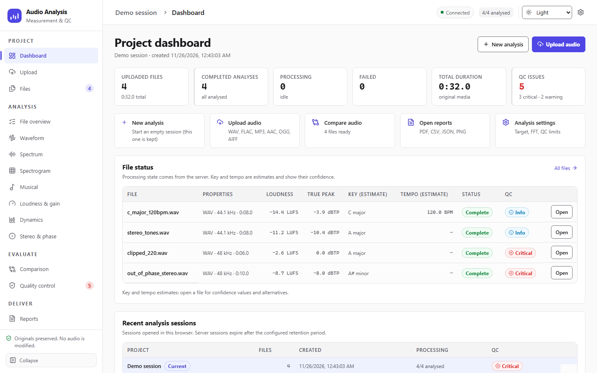 | 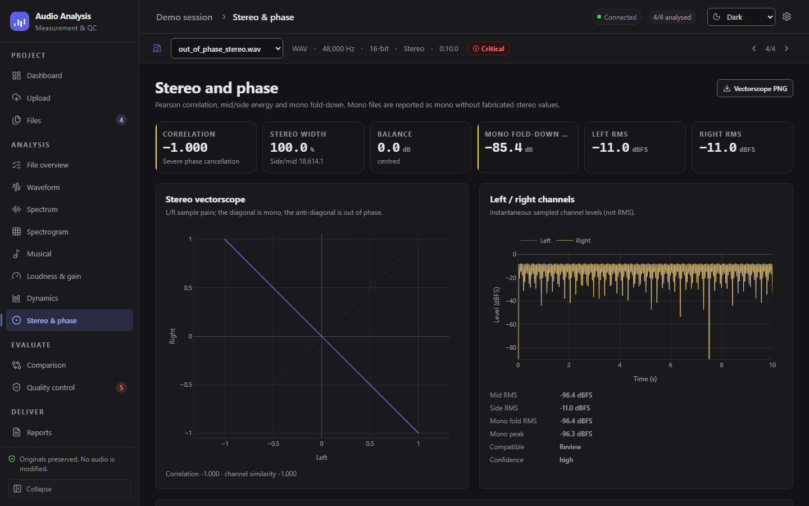 |
| **Waveform** — peak/RMS envelope, detected beats, selection and segment analysis | **Spectrogram** — log-frequency STFT, side-by-side files |
| 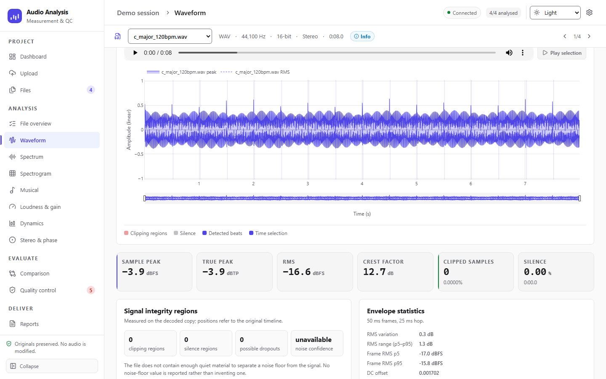 | 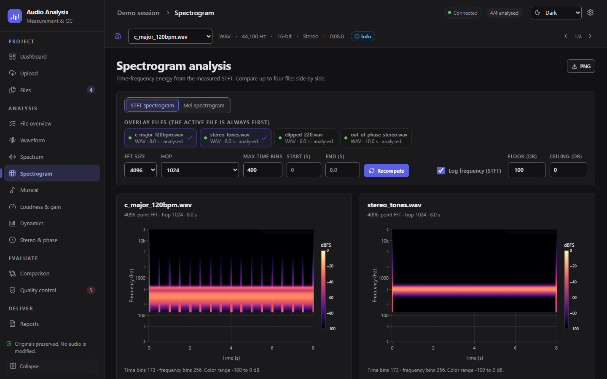 |
| **Comparison** — file summary and tolerance-based parameter table | **Quality control** — every finding with measured value, limit and time position |
| 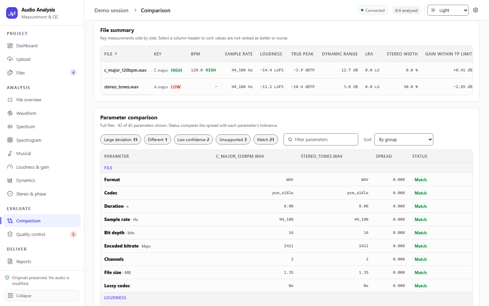 | 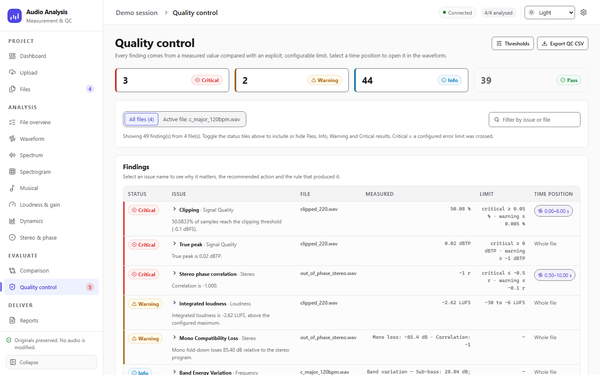 |

<p align="center">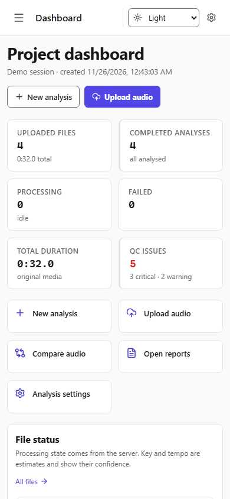<br><sub>Responsive down to 390 px</sub></p>

Screenshots use the generated reference signals in `backend/data/test_audio`.

---

## 1. What it measures

| Area | Measurements |
| --- | --- |
| Loudness | Integrated LUFS, momentary (400 ms) and short-term (3 s) loudness, loudness range (EBU Tech 3342), relative gate, sample peak, **true peak** (4× oversampling, BS.1770-4 Annex 2), PLR, crest factor |
| Time domain | RMS, sample peak, DC offset, clipping (sample threshold + flat-top count + regions), silence and digital silence, dropouts, noise floor, SNR, waveform envelopes, peak/min buckets |
| Spectral | Average FFT magnitude (dBFS-calibrated), peaks, dominant frequency, STFT spectrogram, Mel filterbank, chroma, centroid, bandwidth, roll-off, flux, flatness, zero-crossing rate, spectral contrast, HPSS and harmonic/percussive ratio, 7 production frequency bands |
| Musical (estimates) | Key with confidence and alternatives, tempo with beat grid, half/double-time candidates, local tempo, onset/rhythm statistics, F0 (pyin) contour, note transitions, pitch distribution |
| Stereo | Pearson correlation, phase correlation, channel similarity, mid/side RMS, stereo width, balance, mono fold-down loss and peak, vectorscope, correlation/width timeline, phase regions |
| Dynamics | Crest factor, RMS variation and range, loudness range, short-term variation, transient strength, reduced-dynamic sections, compression indicators |
| Metadata | Format, container, codec, sample rate, channel count, PCM bit depth (lossless only), encoded bitrate (lossy only), file size, SHA-256 |

Mono files are analysed as mono: stereo correlation, width and fold-down metrics are **not** fabricated,
and the API returns `stereo.supported = false` with an explanation.

## 2. Quality control

Each analysed file receives a deterministic QC pass with four classifications:

| Class | Meaning |
| --- | --- |
| **Normal** | Measured value is inside the configured range |
| **Information** | Factual observation with no threshold breach (e.g. “noise floor not separable”) |
| **Warning** | A configured warning threshold was crossed — review against the artistic goal |
| **Error** | A configured error threshold was crossed — a measured problem |

Every finding carries: measured value, threshold, unit, explanation, recommendation, confidence,
time positions and the relevant standard. Thresholds are stored per session, editable in the UI, and
re-applied through `POST /api/sessions/{id}/qc/recompute` without re-running the audio analysis.

## 3. Comparison and alignment

* Tolerance-based comparison of 40+ parameters grouped into File, Loudness, Dynamics, Signal quality,
  Stereo, Musical, Spectral and Frequency bands.
* Status per parameter: `match`, `different`, `large_deviation`, `low_confidence`, `unsupported`.
* Optional reference file, per-file deviations, segment mode (compare arbitrary time ranges), gain
  preview table and cross-file findings.
* Alignment via automatic cross-correlation (100 Hz RMS envelope and decimated waveform) or a manual
  offset, with a confidence score. Alignment only shifts the *display*; the audio is untouched.

## 4. Reports

| Export | Content |
| --- | --- |
| PDF | Combined report: cover, per-file measurement tables, embedded plots, QC findings, comparison tables |
| JSON | Full analysis payloads, settings, methods, confidence, QC and optional comparison |
| CSV | One row per file with the key measurements |
| QC CSV | One row per QC check with severity, value, threshold, time positions, recommendation |
| Comparison CSV | One row per parameter with values, tolerance, spread and status |
| PNG | 14 server-rendered per-file plot types (waveform, spectrum, spectrogram, mel, chroma, loudness, RMS/peak, bands, vectorscope, dynamics, tempo, pitch, spectral features, stereo) plus 3 comparison plots |

## 5. Quick start

Requirements: **Python 3.11 or 3.12** (64-bit) and **Node.js 22.12+** (only to build the dashboard).
No system FFmpeg or codec installation is needed — see [Supported platforms](#12-supported-platforms).

```bash
# 1. Backend
cd backend
python -m venv .venv
.venv\Scripts\activate            # Windows (PowerShell / cmd)
# source .venv/bin/activate       # macOS / Linux
pip install -r requirements.txt

# 2. Frontend (production build served by FastAPI)
cd ../frontend
npm ci
npm run build

# 3. Run
cd ../backend
python -m uvicorn app.main:app --host 127.0.0.1 --port 8000
```

Open <http://127.0.0.1:8000>. The API documentation is served at `/api/docs` and health at `/api/health`.

For frontend development with hot reload run `npm run dev` in `frontend/` and start the backend on
port 8000 (Vite proxies `/api` to `127.0.0.1:8000`).

Full instructions: [docs/INSTALLATION.md](docs/INSTALLATION.md) · Deployment: [docs/DEPLOYMENT.md](docs/DEPLOYMENT.md)

## 6. Reference material and validation scripts

```bash
# Deterministic reference signals (sines, clicks, chords, clipped and out-of-phase files)
python scripts/generate_test_audio.py --out backend/data/test_audio

# Measure every reference file with the real pipeline and print the validation table
python scripts/validate_reference_signals.py --audio backend/data/test_audio

# Cross-check the built-in BS.1770-4 meter against the independent pyloudnorm implementation
python scripts/validate_loudness_against_pyloudnorm.py --audio backend/data/test_audio

# End-to-end HTTP smoke test against a running server
python scripts/smoke_test.py --base http://127.0.0.1:8000
```

## 7. Tests

```bash
cd backend
pip install -r requirements-dev.txt
python -m pytest            # 106 tests, ~60 s (measurements, API, reports, regressions)

cd ../frontend
npm test                    # 46 Vitest unit tests (validation, formatting, routing, themes)
npx tsc -b && npm run build # strict type-check and production build
```

Browser tests (Playwright + Chromium against the real backend and real audio, 40 tests):

```bash
pip install -r frontend/e2e/requirements.txt && python -m playwright install chromium
cd backend && python -m uvicorn app.main:app --port 8765     # separate terminal
python -m pytest frontend/e2e -q                             # from the repository root
python frontend/e2e/audit.py --out <dir> --theme light       # axe-core WCAG 2.2 AA, overflow, console audit
```

Visual-regression baselines are platform-specific; set `AAP_SKIP_VISUAL=1` on a different OS
(CI does this on Linux). The design system is documented in [docs/DESIGN_SYSTEM.md](docs/DESIGN_SYSTEM.md).

The suite validates measurements against analytic references and an independent implementation
(`pyloudnorm`), covers the API end-to-end, and checks report generation. Results:
[docs/VALIDATION.md](docs/VALIDATION.md).

The loudness meter was cross-checked against `pyloudnorm` on all 17 reference files: the mean
difference was **0.0033 LU** and the worst difference **0.0061 LU**.

## 8. Architecture

### System overview

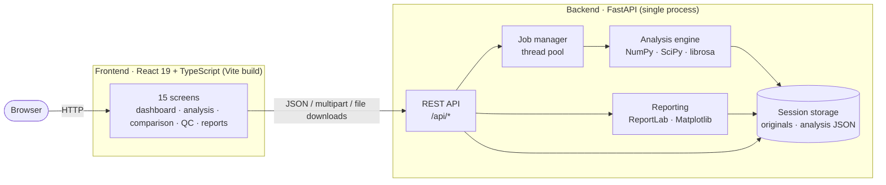

FastAPI also serves the built frontend (`frontend/dist`), so one process on one port runs everything.
All processing is local; no external audio service is contacted.

### Backend

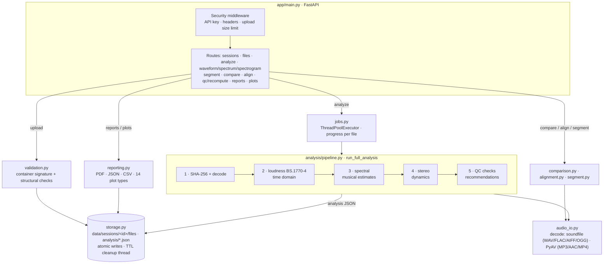

### Frontend

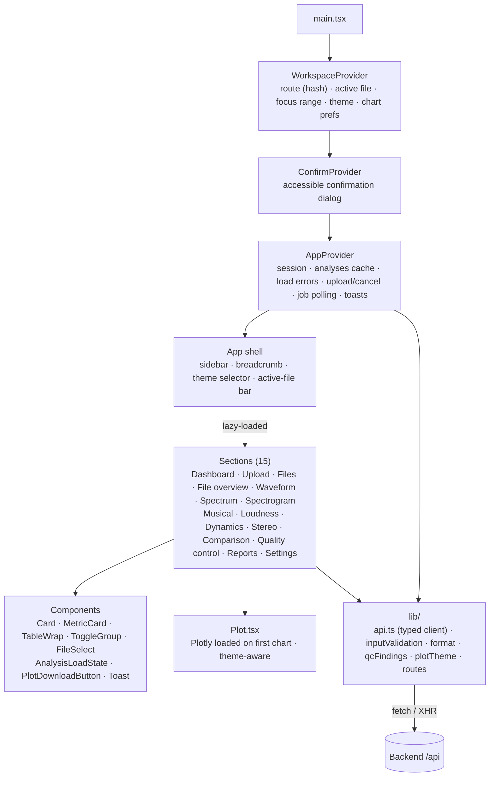

### Analysis request flow

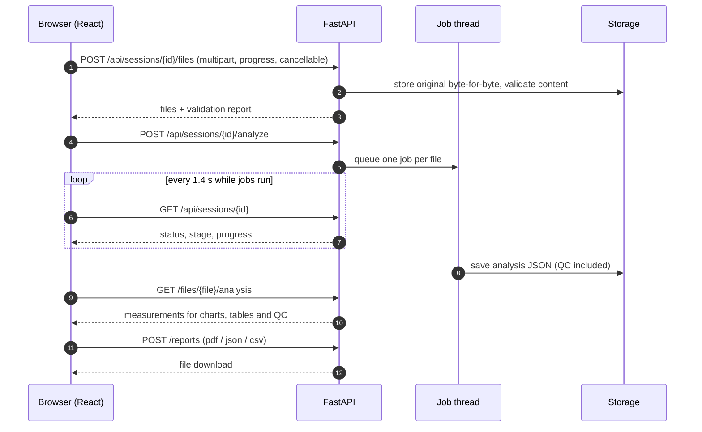

## 9. Project layout

```
audio_analysis_pipeline/
├── backend/
│   ├── app/
│   │   ├── main.py              # FastAPI app, routes, static serving
│   │   ├── config.py            # environment-driven settings and limits
│   │   ├── storage.py           # session/file/analysis persistence
│   │   ├── validation.py        # container sniffing and structural checks
│   │   ├── audio_io.py          # decoding (soundfile + PyAV)
│   │   ├── jobs.py              # background job manager
│   │   ├── reporting.py         # CSV/JSON/PDF builders and plot renderers
│   │   └── analysis/            # loudness, time_domain, spectral, musical,
│   │                            # stereo, dynamics, qc, comparison, alignment,
│   │                            # segment, pipeline, utils
│   ├── data/test_audio/         # reference signals used by the tests
│   ├── tests/                   # pytest suite
│   ├── requirements.txt
│   └── requirements-dev.txt
├── frontend/
│   ├── src/sections/            # 15 dashboard screens
│   ├── src/components/          # UI kit, dialogs, file select, plot wrapper, toasts
│   ├── src/state/               # session state, workspace (route, active file, theme)
│   ├── src/lib/                 # typed API client, validation, formatting, plot theme
│   └── e2e/                     # Playwright browser tests and accessibility audit
├── scripts/                     # reference-signal generation and validation
├── docs/                        # installation, deployment, technical, validation, design system
│   └── images/                  # README screenshots
├── .github/workflows/ci.yml     # tests on Linux, Windows and macOS
├── LICENSE                      # Apache-2.0
├── NOTICE                       # attribution and third-party notices
├── CHANGELOG.md · CONTRIBUTING.md · SECURITY.md
└── .gitignore
```

## 10. Dashboard sections

1. Dashboard — session health, per-file verdicts, recommendations, overview charts
2. Upload — drag-and-drop batch upload with validation feedback
3. Files & validation — metadata, validation report, per-file analysis state
4. File overview — every measurement of one file with status, unit and confidence
5. Waveform — peak/RMS envelopes, clipping/silence regions, selection zoom and segment analysis
6. Spectrum — average FFT, spectral peaks, band balance, spectral features
7. Spectrogram — STFT/Mel, log-frequency view, per-file comparison
8. Musical — key, chroma, tempo/beats, pitch
9. Loudness & gain — integrated/momentary/short-term loudness, true peak, gain preview
10. Dynamics — crest, RMS, LRA, transient strength, compression indicators
11. Stereo & phase — vectorscope, correlation, width, mono compatibility
12. Comparison — multi-file parameter comparison, alignment, gain preview
13. Quality control — findings, time positions, threshold editor
14. Reports — PDF/CSV/JSON exports and per-plot PNG
15. Settings — session parameters, appearance, system information

## 11. Safety and privacy

* Originals are stored unmodified; every operation is read-only on the source file.
* Analysis artifacts (JSON), plots and reports are stored separately from the audio.
* Sessions expire automatically (`AAP_SESSION_TTL_HOURS`, default 12 h) and are removed by a cleanup
  thread.
* Optional API key protection (`AAP_API_KEY`) and security headers are applied to all `/api` routes.
* All processing is local to the server — no third-party audio service is contacted.

## 12. Supported platforms

The code itself is OS-independent (`pathlib` paths, atomic `os.replace` writes, threads rather than
processes, headless Matplotlib). Platform support therefore follows the binary wheels of the native
dependencies (PyAV/FFmpeg, soundfile/libsndfile, NumPy/SciPy, Numba):

| OS | Architectures | Status |
| --- | --- | --- |
| Windows 10 / 11 | x86-64 | **Supported — fully tested** (all backend, unit and browser suites, accessibility audit) |
| macOS 12+ | Apple silicon (arm64), Intel (x86-64) | Supported by all dependencies (official wheels); verified by the CI backend and frontend jobs on `macos-latest` |
| Linux (glibc, e.g. Ubuntu 22.04+, Debian 12+, Fedora) | x86-64, ARM64 | Supported by all dependencies (official wheels); verified by the CI backend, frontend and browser jobs on `ubuntu-latest` (x86-64) |
| Linux with musl (Alpine) | — | Not supported out of the box (no musl wheels for PyAV/Numba); use a glibc base image |
| 32-bit systems | — | Not supported |

Browsers: current Chrome, Edge, Firefox and Safari. Automated browser tests run on Chromium only.
Python 3.13 depends on Numba/librosa wheel availability and is not yet part of CI. Until the first CI run on
GitHub completes, macOS and Linux have not been exercised by this project's own tests — only Windows 11 has.

## 13. License

Copyright 2026 The Audio Analysis Pipeline Authors.
Licensed under the **Apache License, Version 2.0** — see [LICENSE](LICENSE). Attribution and
third-party notices are in [NOTICE](NOTICE).

Measurement implementations follow the published standards (ITU-R BS.1770-4, EBU R128, EBU Tech 3342);
no third-party implementation code is included. Dependencies are installed separately and keep their own
licences. Note that the PyAV binary wheels bundle FFmpeg together with GPL-licensed x264/x265 libraries: if
you **redistribute** a packaged build (Docker image, installer) that contains them, follow those licences
as described in NOTICE.

Contributing: [CONTRIBUTING.md](CONTRIBUTING.md) · Security reports: [SECURITY.md](SECURITY.md) ·
Release notes: [CHANGELOG.md](CHANGELOG.md)
